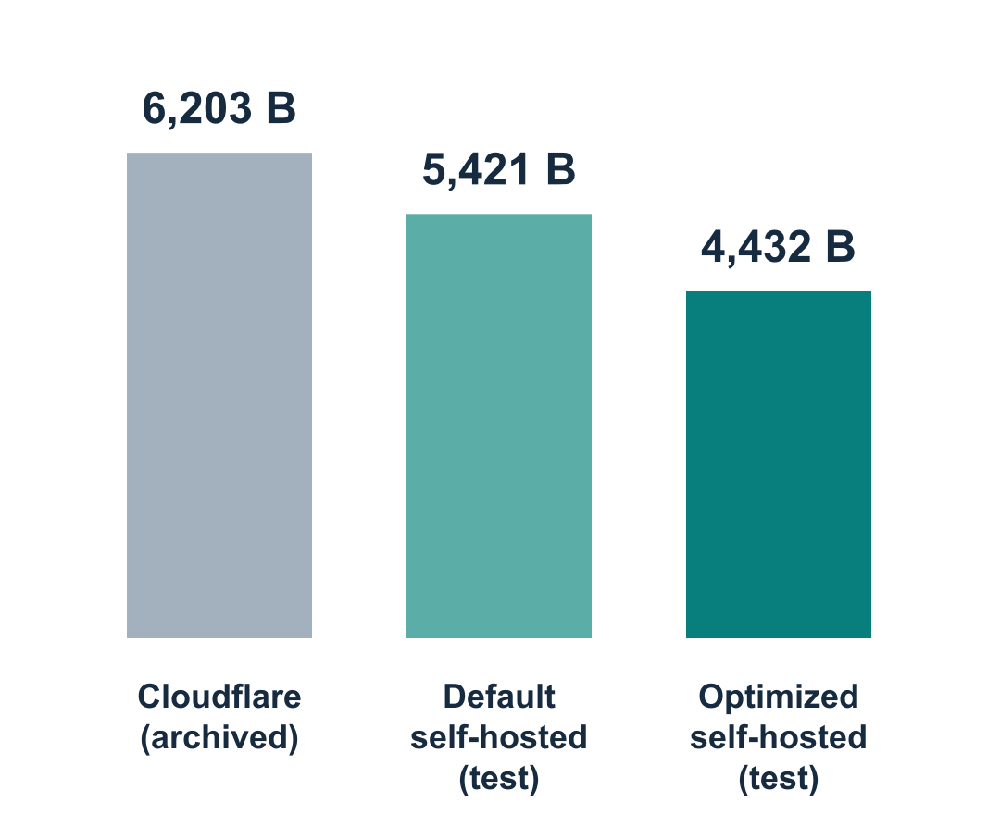

# 1kb website

My personal page at [tomkimberlin.com](https://tomkimberlin.com/), and an experiment in HTTPS delivery overhead. One HTML document carries the text, CSS and direct links, with native light/dark styling and no scripts or font downloads.

Certificates and connection setup cost more than the page itself. Precompressed bodies and patched nginx/OpenSSL builds reduce those bytes while preserving certificate validation and connection reuse. I built the original page years ago; Astra helped optimize it. [How it works](OPTIMIZATION.md).

## Delivery overhead



Self-hosted bars compare stock and optimized nginx with the same test certificate chain. Values exclude the entire page body, TCP/IP and DNS. Cloudflare is a separate archived temporary-route control, not a universal provider comparison. The trusted live result remains 5,252 B with its different certificate. [Definition, samples and method](docs/delivery-overhead/).

### Separate packet-and-DNS estimate

This broader measure counts traffic through connection close, including estimated TCP/IP and DNS.

**Delivery overhead = measured traffic − the entire encoded page body.**

**Latest verified result: 6,945 B estimated overhead, October 25, 2026.** Three cold own-site exchanges (6,944–6,996 B), measured before the project-name update below. [Evidence](measurements/overhead-20261025-adjacent.json).

<details>
<summary>Current page sizes and 1KB Club qualification</summary>

| Measurement | Scope | Built October 25, 2026 |
| --- | --- | ---: |
| Brotli response body | Encoded page body | 396 B |
| Gzip response body | Encoded page body | 549 B |
| Deflate response body | Encoded page body | 537 B |
| Raw HTML | Decoded page | 1,039 B |

The [October 25 page update](measurements/maintenance-20261025-intune-name.json) uses **Intune Device Workbench**. The longer name and URL add 7 B to the Brotli body; no new delivery-overhead measurement is claimed.

The last [1KB Club](https://1kb.club/submit/) scanner check was October 5: [report](https://www.debugbear.com/test/website-speed/Gv3z2tDz/overview), [evidence](measurements/debugbear-20261005.json).

</details>

## Build

Use a current supported Node.js release (CI pins 24.22.1), npm, curl, `sh` and Bash:

```sh
npm ci
npm test
npm run check
npm run check:measurements
```

`index.html` is the source; the build writes four representations and nginx's preload snapshot to `public/`, plus [build-report.json](build-report.json). Keep source ASCII and use character references for Unicode. The 128 B response allowance is a build budget. The measurement check validates [saved build evidence](measurements/page-20261025-intune-name-local.json), not a new live result.

Optional browser comparisons need Playwright (`npm install --no-save --package-lock=false playwright`) and Chromium/WebKit (`npx playwright install chromium webkit`). Save the original HTML before editing, then run `npm run test:browser -- --baseline PATH_TO_ORIGINAL_HTML`. Python optimizer tests (`npm run test:optimizers`) need Python 3.

## Hosting

nginx runs directly on an Unraid/Docker host; Cloudflare provides DNS only. This control requires maintaining the server and patches, with availability tied to home power and connectivity. See [hosting and rollback](server/README.md) and [protocol verification](TRANSPORT.md#verification). GitHub pushes do not deploy the site.
